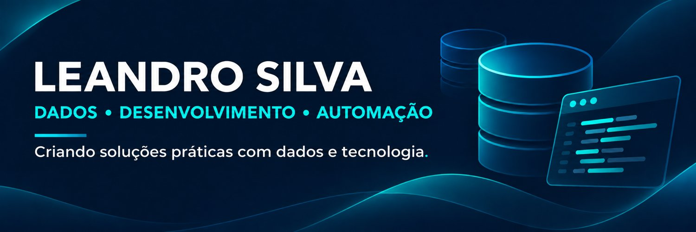

📍 Contagem, Minas Gerais, Brasil

---

## 👨‍💻 Sobre mim

Sou formado em **Análise e Desenvolvimento de Sistemas pela Una** e atuo com integração de dados, desenvolvimento de aplicações e automação de processos.

Na **CheckMultas**, trabalho com arquivos de sistemas legados, consultas SQL, cargas em PostgreSQL e aplicações Java/Spring. Gosto de criar ferramentas que simplificam tarefas manuais e contribuem para a qualidade dos dados.

Minha trajetória também inclui suporte e implantação de sistemas. Mantenho uma rotina de estudos práticos para revisar conhecimentos e desenvolver novas habilidades.

## 🧰 Tecnologias e práticas

- **Dados:** SQL, PostgreSQL, MySQL, Python e Excel.
- **Desenvolvimento:** Java, Spring Boot e JavaScript.
- **Integração e qualidade:** ETL, tabelas de staging, validação, limpeza e padronização de dados.
- **Ferramentas:** Git, GitHub e SheetJS.

## 🚀 Projetos em destaque

### 🚗 [Vehicula · Ferramentas](https://leandrojs82.github.io/vehicula/)

Aplicação web com ferramentas para tratamento de dados de frotas e placas. Apoia a preparação e a padronização de arquivos para cargas no PostgreSQL.

**Tecnologias:** JavaScript e SheetJS  
**Foco:** automação e qualidade de dados.

🔗 [Experimentar o Vehicula](https://leandrojs82.github.io/vehicula/)

### 🧩 [Omnia](https://omnia-virid-ten.vercel.app/)

Coleção de ferramentas web desenvolvida em JavaScript puro, reunida em um único arquivo HTML e acompanhada de testes automatizados.

**Tecnologias:** HTML e JavaScript  
**Foco:** utilitários web e automação de tarefas.

🔗 [Experimentar o Omnia](https://omnia-virid-ten.vercel.app/)

### 📚 [Desafio Full Stack Semanal](https://github.com/leandrojs82/Desafio_Full_Stack_Semanal)

Repositório de **estudo contínuo**, criado para revisar conhecimentos, praticar tecnologias e registrar minha evolução por meio de pequenos projetos.

Entre os desafios estão um gerador de QR Code, uma análise de despesas em Python, uma API de ideias com Java e Spring Boot e uma análise de empréstimos em SQL.

**Tecnologias:** HTML, CSS, JavaScript, Python, Java, Spring Boot e PostgreSQL  
**Foco:** aprendizado contínuo e documentação dos conhecimentos.

🔗 [Conhecer o repositório](https://github.com/leandrojs82/Desafio_Full_Stack_Semanal)

## 💼 Experiência

### CheckMultas

Atuo com integração e qualidade de dados e desenvolvimento de aplicações. Meu trabalho envolve arquivos legados, validação de registros veiculares e infrações, comparação de relatórios e desenvolvimento Java/Spring.

Essa atuação está inserida em sistemas de gestão de frotas que somam **mais de 800 mil veículos**.

### Villefort Consulting

Construí uma trajetória de **mais de 10 anos** com suporte, implantação de sistemas e dados, incluindo a implantação de **mais de 30 convênios** com órgãos públicos e instituições bancárias.

## 🤝 Vamos conversar?

Estou aberto a oportunidades remotas como **Analista de Dados Jr. ou Programador Jr.**, especialmente em projetos que envolvam integração de dados, automação e desenvolvimento Java.

💼 [LinkedIn](https://www.linkedin.com/in/leandro-silva82/)  
✉️ [E-mail](mailto:leandrojs1982@gmail.com)
